# Catatku — Pencatat Uang Pribadi

Aplikasi **PWA mobile-first** untuk mencatat pemasukan & pengeluaran harian: sisa uang, arus kas bulan ini, grafik, kategori, riwayat, target tabungan, batas belanja, pengingat harian, serta pengaturan akun. Dibangun sesuai PRD (`PRD.md`) dan 8 spesifikasi halaman di folder ini.

> 🌐 **Live:** **https://catatku-dun.vercel.app** — berjalan 24/7 di **Vercel + Turso (libSQL cloud)**, jadi tetap hidup walaupun laptop dimatikan. Bisa dipasang sebagai PWA di iPhone. Update terbaru (2 Nov 2026) sudah dipublikasikan: **Meja Trading** — inspeksi saham AS + latihan trading uang kertas.

## ✨ Fitur

| Fase | Fitur | Status |
| --- | --- | --- |
| 1 | Catat pengeluaran & pemasukan (nominal, kategori, tanggal, catatan) | ✅ |
| 1 | Ubah & hapus transaksi dengan konfirmasi | ✅ |
| 1 | Beranda: sisa uang, ringkasan bulan ini, tombol catat cepat, transaksi terakhir | ✅ |
| 2 | Grafik masuk vs keluar + per kategori, rentang minggu/bulan/tahun | ✅ |
| 2 | Kategori bawaan + CRUD kategori dengan ikon & warna | ✅ |
| 2 | Riwayat: cari, filter (kategori/jenis/tanggal), kelompok per hari, muat lebih banyak | ✅ |
| 2 | Riwayat: hapus banyak transaksi sekaligus (mode pilih → hapus) | ✅ |
| 3 | Target tabungan (progres %) + batas belanja bulanan + status pemakaian | ✅ |
| 3 | Pengingat harian (jam/hari/toggle) + notifikasi batas belanja + notifikasi browser | ✅ |
| 4 | Daftar/masuk/keluar akun, profil, mata uang, tema terang/gelap | ✅ |
| 4 | Ekspor CSV/JSON + pulihkan cadangan JSON | ✅ |
| 4 | Hapus akun permanen (konfirmasi kata sandi + ketik HAPUS) | ✅ |
| — | **Integrasi BCA**: transaksi dari email notifikasi BCA masuk Kotak Masuk + impor mutasi/e-Statement PDF | ✅ |
| — | PWA: manifest, ikon, service worker, offline fallback, install prompt | ✅ |
| — | Data terisolasi per pengguna (sesi cookie + `user_id` di semua tabel) | ✅ |

> 🔗 Integrasi BCA (email & impor mutasi) dijelaskan di [docs/BCA-INTEGRATION.md](docs/BCA-INTEGRATION.md). MyBCA tidak punya API publik untuk rekening pribadi, jadi auto-catat memakai email notifikasi resmi BCA (dengan langkah konfirmasi).

## 📈 Meja Trading (paper trading saham AS)

Modul baru yang mengubah Catatku jadi tempat latihan **setup trading + inspeksi saham AS**. Diadaptasi dari paket skill day-trader (scanner, news, entry, exit, time machine, risk, budget, broker, alerts, analyst) menjadi UI + API di dalam aplikasi ini. **Semua order kertas** — tidak ada broker, tidak ada uang sungguhan, tidak ada kunci API.

| Fitur | Isi |
| --- | --- |
| **Inspeksi saham** | Cari simbol → laporan lengkap: harga & perubahan, grafik 5 menit + 3 bulan (SVG), RSI 14, MA20/50, ATR 14, high/low 20 hari & 52 minggu, rentang awal, setup yang cocok, berita Yahoo Finance + filing 8-K SEC, fundamental XBRL SEC (pendapatan, laba, EPS, margin, 1 tahun, YoY), catatan risiko |
| **Pemindai saham** | "Cari setup": scan 100 saham AS paling likuid (atau daftar pantau): 5 setup harian (tembus 20 hari, bull flag, reclaim MA20, oversold, oversold bounce) dan **tembus rentang awal** intraday; hasil → Periksa / Buat rencana / Daftar pantau |
| **Rencana trading** | Harga masuk, batas rugi (tengah/bawah rentang awal, harga, %, kelipatan ATR), target untung 1R/1.5R/2R/harga, imbalan:risiko, jumlah lembar otomatis (4 batas: rugi/trade, ukuran posisi, nilai order, kas setelah buffer), 13 cek risiko |
| **Uji peluang (Time Machine)** | 2.000 simulasi bootstrap dari ±60 sesi bar 5 menit: peluang target dulu / stop dulu / tidak keduanya, rata-rata R, riwayat per sesi — bahan uji, bukan prediksi |
| **Order & jurnal latihan** | Isi order saat harga masuk kena, tutup saat batas rugi/target/jam keluar, order ditolak bila melewati batas risiko, jurnal hasil latihan |
| **Pengingat harga** | Pengingat di atas/bawah level, batas rugi, target untung, perubahan %, bel pembukaan, dan jam keluar; tiga pengingat sekali klik dari rencana aktif; notifikasi browser selama halaman terbuka |
| **Pengaturan risiko** | Modal latihan, batas rugi/trade, ukuran posisi & order, kas disisakan, batas rugi harian, jumlah trade/hari, jam masuk, jam keluar, minimal imbalan:risiko |
| **Jam bursa NYSE** | Pra-pasar/buka/pasca-pasar/tutup, libur bursa 2026–2027, penutupan dini 13.00 ET (jam keluar otomatis 12.55 ET) |

**Bahasa & prioritas:** fitur penting tampil dulu (cari saham, harga, rencana aktif, posisi, pengingat, batas risiko); detail lanjutan dilipat dalam "Detail teknikal", "Fundamental (lanjutan)", "Aturan lanjutan", dan pengaturan "Lanjutan". Istilah memakai bahasa sehari-hari: **harga masuk**, **batas rugi (stop)**, **target untung**, **jumlah lembar**, **imbalan : risiko**, **jam keluar (flat by)**, **latihan (uang kertas)**. Panduan lengkap: [docs/UI-COPY.md](docs/UI-COPY.md).

**Data:** Yahoo Finance chart/spark/RSS + SEC EDGAR XBRL — gratis, tidak resmi, bisa tertunda 1–15 menit. Aplikasi selalu menyebut ini dan tidak pernah menyebut harga "real time". Bukan saran finansial; sebagian besar day trader pemula kehilangan uang.

**Halaman:** `/trading` (meja), `/trading/inspeksi`, `/trading/scan`, `/trading/rencana`, `/trading/posisi`, `/trading/alert`, `/trading/pengaturan`. Kontrak teknis modul: [docs/TRADING.md](docs/TRADING.md).

**Akun demo:** tombol "Coba akun demo" (hanya di pengembangan lokal) sudah menyertakan pengaturan risiko, daftar pantau contoh (TSLA, NVDA, AAPL, PLTR, MSFT), 1 rencana aktif, 1 jurnal latihan, dan 3 pengingat. Di produksi akun demo dinonaktifkan — gunakan akun pribadi hasil **Daftar**. Untuk menyiapkan tabel modul di database Turso produksi: `node --env-file=.env.local scripts/migrate.ts`.

## 📸 Tangkapan layar

| Beranda | Catat transaksi | Riwayat |
| --- | --- | --- |
| 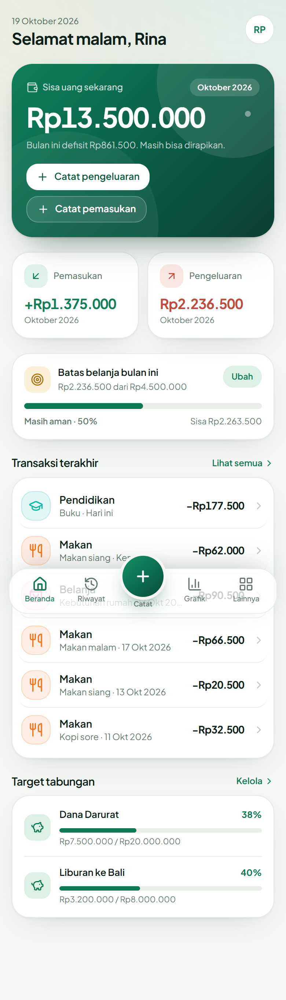 | 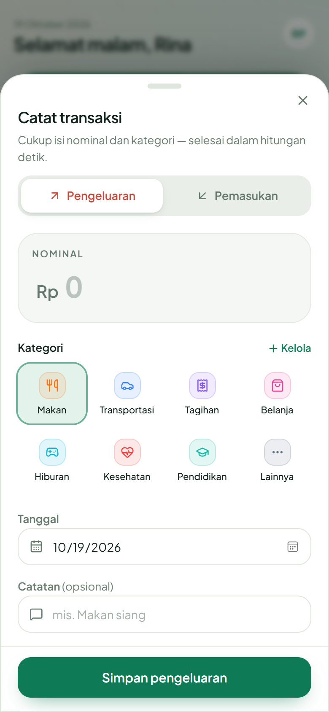 | 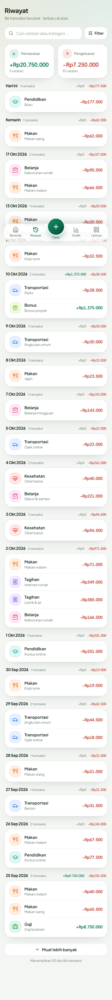 |

| Grafik | Kategori | Target & progres |
| --- | --- | --- |
| 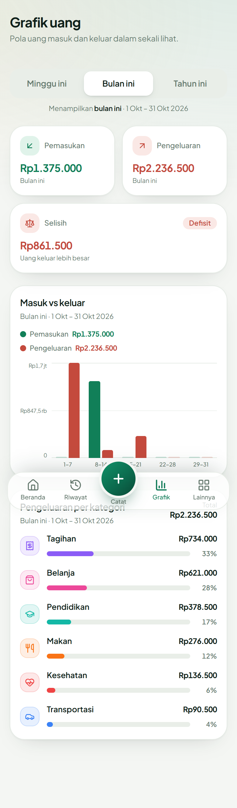 | 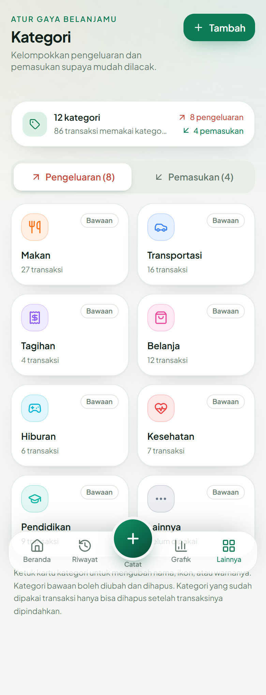 | 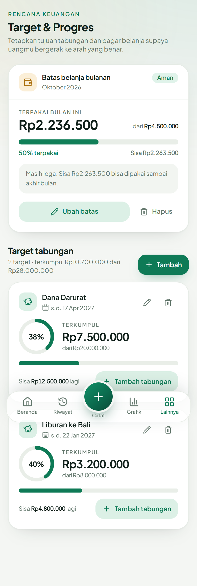 |

| Pengingat | Mode gelap | Desktop |
| --- | --- | --- |
| 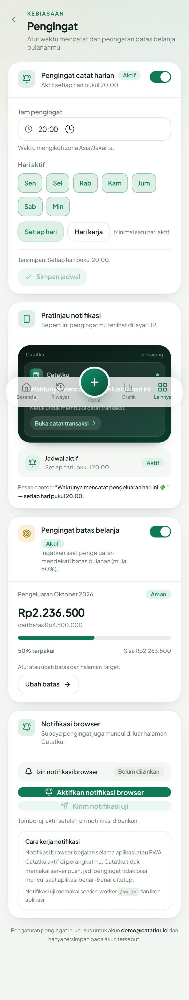 | 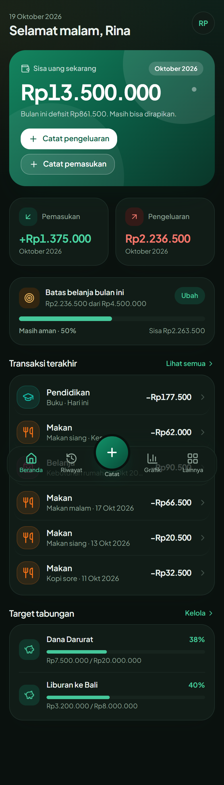 | 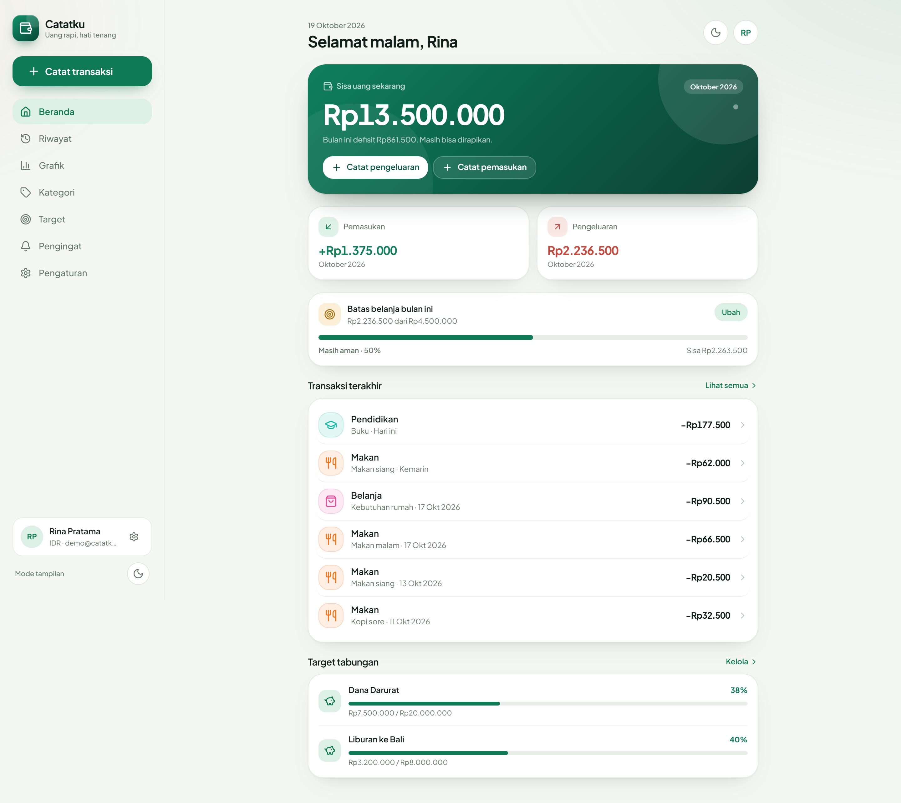 |

| Kotak Masuk (integrasi BCA) | Integrasi di Pengaturan |
| --- | --- |
| 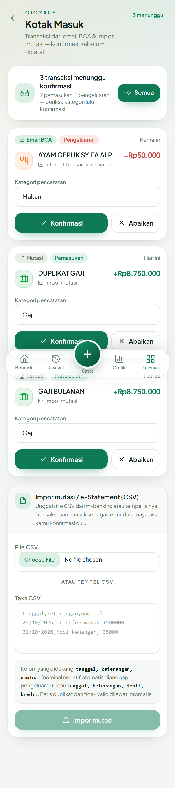 | 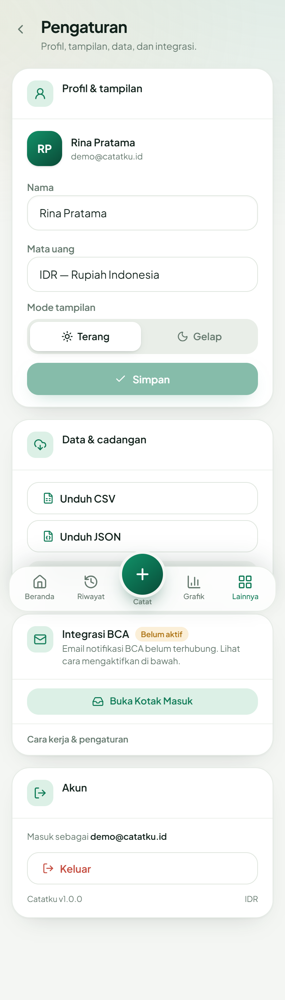 |

| Meja Trading | Inspeksi saham (TSLA) | Pemindai saham |
| --- | --- | --- |
| 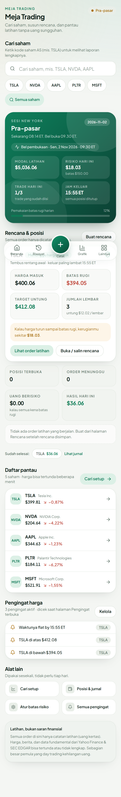 | 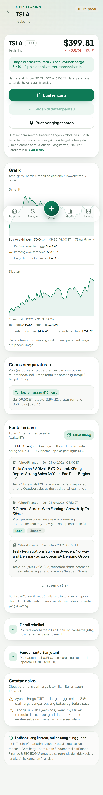 | 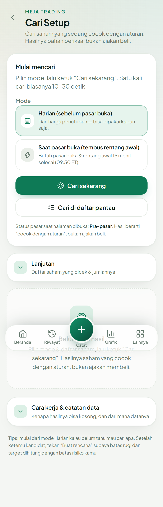 |

| Rencana + Uji peluang | Posisi & jurnal latihan | Pengingat harga |
| --- | --- | --- |
| 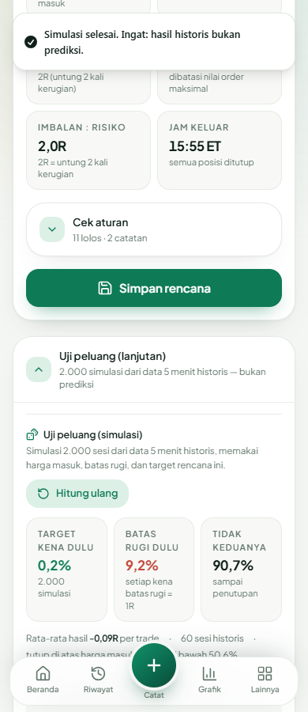 | 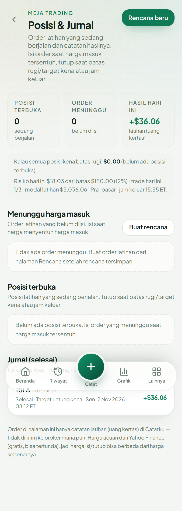 | 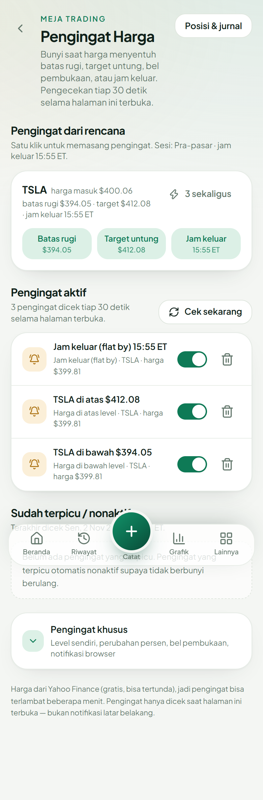 |

Semua screenshot dihasilkan dari build produksi dengan akun demo (folder `docs/screenshots/`). Tangkapan login, validasi form, filter riwayat, editor kategori, dan grafik desktop juga tersedia di sana. Screenshot modul trading ada di `docs/screenshots/trading/`.

## ✅ Verifikasi

- `npm run build` **sukses** — **69 route** (21 halaman + 46 API), middleware, dan pemeriksaan TypeScript bersih.
- Uji end-to-end browser (Edge headless via Playwright): **12/12 alur lulus**, **0 error console/pageerror**, **0 overflow horizontal** pada 390px & 1440px.
  Alur yang diuji: login demo → catat pengeluaran (termasuk validasi nominal kosong) → sisa uang berubah → riwayat cari/ubah/hapus → kategori tambah/ubah/hapus → target buat/tambah tabungan/hapus → toggle pengingat → ganti mata uang USD↔IDR → tema gelap/terang → ekspor CSV/JSON → proteksi rute tanpa sesi → logout → manifest/ikon/service worker.
- **Meja Trading**: build produksi diverifikasi (`next start`), 8 halaman trading + 12 endpoint trading **200**, **0 overflow** di 390px & 1440px, **0 error console**. Uji alur browser **12/12 lulus** (versi UI baru): pilih batas rugi cepat → target 2R → hitung rencana → Uji peluang → simpan → order latihan → isi order → tutup posisi → jurnal → 3 pengingat dari rencana → pengaturan → dashboard. Scan 100 saham (mode harian) diuji live: 99/100 chart, 31 sinyal dalam ±11 detik.
- **Meja Trading putaran 2 (bahasa & prioritas)**: sapu bug 7 halaman + 39 tautan internal (semua 200), 16 API utama 200, 401 tanpa sesi benar; perbaikan `<a><button>` bersarang di 4 halaman, target sentuh ≥40px (chip dashboard, tombol kembali, hapus pengingat), pesan validasi Zod berbahasa Indonesia (pengaturan & rencana), jargon "flat by"/"ORB"/"semesta"/"jt" dibersihkan, `quote` kosong mengembalikan `{ quotes: [] }` tanpa pesan error campur. Detail teknis & glosarium: [docs/UI-COPY.md](docs/UI-COPY.md).
- **Deploy produksi (Vercel)**: https://catatku-dun.vercel.app — build Vercel sukses (69 route). Diverifikasi langsung di produksi: halaman login 200, `/trading` tanpa sesi → redirect login (307), registrasi akun uji 201 → `/trading`, `/api/trading/settings`, `/api/trading/quote`, `/trading/inspeksi/TSLA`, dan `/api/trading/scan` semuanya **200**; akun uji dihapus kembali (200).
- PWA: manifest + 4 ikon + `sw.js` terdaftar dan aktif di build produksi.
- Integrasi BCA diuji dengan **email asli** (`Internet Transaction Journal`): nominal Rp50.000, tanggal 19 Okt 2026, merchant “AYAM GEPUK SYIFA” terbaca benar (confidence high) + impor mutasi CSV, konfirmasi, dan deduplikasi lulus.
- `docs/FOUNDATION.md` berisi kontrak internal (skema data, API, komponen) yang dipakai saat pengembangan; `docs/TRADING.md` berisi kontrak modul Meja Trading.
- Skrip QA modul trading: `node scripts/trading-check.mjs` (halaman + API + screenshot) dan `node scripts/trading-interactions.mjs` (alur interaktif).


## 🧱 Stack

- **Next.js 15** (App Router, Server Components, Route Handlers) + **React 19** + **TypeScript**
- **Tailwind CSS v4** dengan design token terang/gelap (shadcn-style UI kit ditulis sendiri di `src/components/ui`)
- **Drizzle ORM + libSQL** — lokal memakai file SQLite (`data/app.db`), produksi serverless memakai **Turso** (`TURSO_DATABASE_URL`). Migrasi SQL di `drizzle/` dan dijalankan otomatis.
- **Autentikasi sesi sendiri**: scrypt (`node:crypto`) + cookie HttpOnly + tabel `sessions`, sesuai skema `users`/`sessions` di PRD. *(PRD menyebut Better Auth; karena skema PRD memakai `password_hash`/`sessions.token` sendiri, autentikasi diimplementasikan langsung agar cocok dengan skema tersebut — tanpa dependensi pihak ketiga.)*
- **Zod** untuk validasi input, **Radix UI** untuk dialog/switch, **Sonner** untuk toast, **Lucide** untuk ikon

## 🚀 Menjalankan

> Butuh **Node.js 22.6+** — skrip CLI memanfaatkan dukungan TypeScript native Node. Build produksi diverifikasi di Node 26.
>
> **Mau buka di iPhone / publish ke internet?** Ikuti [docs/PUBLISH.md](docs/PUBLISH.md) — berisi opsi Wi-Fi LAN, tunnel HTTPS, Tailscale, sampai deploy permanen.
>
> **Agar tetap hidup saat laptop dimatikan:** deploy gratis ke **Vercel + Turso** — lihat [bagian rekomendasi di docs/PUBLISH.md](docs/PUBLISH.md#-rekomendasi-vercel--turso-gratis-laptop-boleh-mati).

```bash
npm install

# (opsional) generate ulang migrasi setelah mengubah src/lib/db/schema.ts
npm run db:generate

npm run db:migrate     # menjalankan migrasi SQL
npm run db:seed        # membuat akun demo + data contoh (idempoten)
npm run dev            # http://localhost:3100
```

Migrasi juga dijalankan otomatis saat server pertama kali menyentuh database (`src/lib/db/index.ts`), jadi `npm run dev` langsung bisa dipakai.

Perintah lain:

```bash
npm run build          # build produksi
npm start              # jalankan hasil build (port 3100)
npm run typecheck      # tsc --noEmit
npm run db:reset       # hapus DB lalu migrasi + seed ulang
```

### Skrip QA visual (opsional)

```bash
$env:EDGE_PATH="C:\Program Files (x86)\Microsoft\Edge\Application\msedge.exe"
node scripts/visual-check.mjs     # screenshot semua halaman + deteksi error/overflow
node scripts/qa-interactions.mjs  # uji alur CRUD end-to-end + ekspor + proteksi rute
node scripts/qa-diagnose.mjs      # diagnosa layout & error console per halaman
```

Membutuhkan `playwright-core` (devDependency) dan Microsoft Edge/Chrome terpasang; screenshot disimpan ke `docs/screenshots/`.

### Environment

| Variabel | Default | Keterangan |
| --- | --- | --- |
| `DATABASE_PATH` | `./data/app.db` | Lokasi file SQLite |

> Catatan sandbox: repo ini berisi `.npmrc` minimal. Jika cache npm pengguna tidak writable, jalankan `npm` dengan `NPM_CONFIG_CACHE` diarahkan ke folder workspace.

## 🗂️ Struktur

```
src/
  app/
    (auth)/login, register          Halaman masuk & daftar
    (app)/                          Area setelah login (layout + AppShell + AppProvider)
      page.tsx                      Beranda cashflow
      riwayat/  grafik/  kategori/  target/  pengingat/  pengaturan/  catat/
      trading/                      Meja Trading: meja, inspeksi, scan, rencana, posisi, alert, pengaturan
    api/                            Route handlers (auth, transactions, categories, charts,
                                    goals, budgets, reminders, settings, export, import, trading)
    manifest.ts  loading.tsx  error.tsx  not-found.tsx  offline/
  components/
    ui/                             Komponen dasar (button, card, dialog, input, …)
    app/                            AppShell, AppProvider, konteks
    transactions/                   Sheet catat/ubah transaksi, baris transaksi
    history/ charts/ categories/ goals/ budget/ reminders/ settings/ auth/
    trading/                        ui bersama + dashboard/ scan/ inspector/ desk/
  lib/
    db/                             schema Drizzle, koneksi + auto-migrate, seed demo
    data.ts                         Query server (transaksi, ringkasan, kategori, target, budget)
    analytics.ts                    Agregasi grafik murni (dipakai server & client)
    auth.ts password.ts             Sesi, scrypt, requireUser
    money.ts date.ts                Format uang (minor units) & tanggal Asia/Jakarta
    validation.ts api.ts            Skema Zod + helper respons API
    trading/                        Market clock NYSE, klien Yahoo, teknikal, scan,
                                    plan engine, time machine, berita+SECD, data DB
  middleware.ts                     Proteksi rute berbasis cookie sesi
drizzle/                            Migrasi SQL + journal
scripts/                            migrate / seed / reset
public/                             Ikon PWA + service worker
```

## 🗄️ Skema database

`users`, `sessions`, `categories`, `transactions`, `goals`, `budgets`, `reminders` — semuanya memakai `user_id` untuk isolasi data. Nominal disimpan sebagai **integer satuan terkecil** (Rupiah = 1, USD = cent) agar penjumlahan bebas galat pembulatan. Tanggal transaksi `YYYY-MM-DD` (zona Asia/Jakarta).

Modul trading menambah tabel `trading_settings`, `watchlist_items`, `trade_plans`, `paper_orders`, `price_alerts` (migrasi `drizzle/0002_meja_trading.sql`). Semua **harga & nominal trading disimpan dalam sen** (integer), volume dalam lembar, jam sesi dalam zona New York.

## 🔌 API ringkas

Semua endpoint butuh sesi (kecuali auth). Respons error: `{ error, details? }`.

| Method | Endpoint | Fungsi |
| --- | --- | --- |
| POST | `/api/auth/register`, `/api/auth/login`, `/api/auth/logout`, `/api/auth/demo` | Akun & sesi |
| GET | `/api/auth/me` | Profil sesi aktif |
| GET/POST | `/api/transactions` | Daftar (filter/paginasi) & simpan transaksi |
| GET/PATCH/DELETE | `/api/transactions/[id]` | Detail, ubah, hapus |
| GET | `/api/transactions/summary` | Sisa uang + ringkasan bulan ini |
| GET/POST | `/api/categories`; PATCH/DELETE `/api/categories/[id]` | CRUD kategori (hapus diblokir 409 bila dipakai) |
| GET | `/api/categories/options` | Pilihan ikon & warna |
| GET | `/api/charts?range=week\|month\|year` | Agregasi grafik |
| GET/POST | `/api/goals`; PATCH/DELETE `/api/goals/[id]` | CRUD target tabungan |
| GET/PUT/DELETE | `/api/budgets` | Batas belanja bulanan + pemakaian |
| GET/PUT | `/api/reminders` | Pengaturan pengingat |
| PATCH | `/api/settings/profile`, `/api/settings/theme` | Profil, mata uang, tema |
| GET | `/api/export?format=csv\|json` | Unduh cadangan |
| POST | `/api/import` | Pulihkan cadangan JSON |
| GET/PUT | `/api/trading/settings` | Pengaturan risiko & jam sesi Meja Trading |
| GET | `/api/trading/quote?symbols=`; `/api/trading/search?q=` | Harga terakhir (sen) & cari simbol AS |
| GET/POST/DELETE | `/api/trading/watchlist` | Watchlist saham |
| GET | `/api/trading/scan?mode=daily\|orb&universe=sp100\|mega\|watchlist\|symbols` | Pemindai 5 setup harian / opening-range breakout |
| GET | `/api/trading/inspect/[symbol]`; `/api/trading/news?symbols=`; `/api/trading/fundamentals/[symbol]` | Inspeksi, berita + 8-K, fundamental SEC |
| GET | `/api/trading/entry?symbol=&setup=orb\|level` | Cek pemicu entry (bar 5 menit) |
| POST | `/api/trading/plans/preview`, `/api/trading/plans`; GET/PATCH/DELETE `/api/trading/plans/[id]` | Pratinjau & CRUD rencana trading |
| GET/POST | `/api/trading/orders`; PATCH `/api/trading/orders/[id]` | Order kertas: isi / tutup / batal |
| GET/POST | `/api/trading/alerts`; PATCH/DELETE `/api/trading/alerts/[id]`; POST `/api/trading/alerts/check` | Alert harga & bel bursa |
| POST | `/api/trading/timemachine` | Simulasi peluang rencana (bootstrap historis) |

Detail kontrak lengkap modul trading: [docs/TRADING.md](docs/TRADING.md).

## 🎨 Catatan desain

- Mobile-first (max-width 2xl), sidebar di desktop, bottom nav 5 tab dengan FAB catat cepat; sheet catat transaksi muncul dari bawah di HP dan sebagai dialog di desktop.
- Tema emerald + aksen emas, kartu `rounded-3xl`, bayangan lembut; mode terang/gelap mengikuti token warna.
- Aksesibilitas: label form, `aria-*`, target sentuh ≥40px, kontras memadai, dukungan `prefers-reduced-motion`.
- Uang selalu ditampilkan lewat `formatMoney` (pemisah ribuan & simbol sesuai mata uang pengguna).

## 📝 Batasan yang diketahui

- **Notifikasi**: pengingat harian & peringatan batas belanja bekerja sebagai notifikasi browser + in-app ketika aplikasi/PWA sedang aktif. Push notification latar belakang sungguhan memerlukan server push (VAPID) + penjadwal; belum disertakan agar aplikasi tetap bisa berjalan tanpa layanan eksternal.
- **Offline**: service worker menyediakan fallback halaman offline dan cache aset, tetapi transaksi baru tetap memerlukan koneksi ke server (sesuai PRD: offline bersifat opsional).
- **Mata uang**: mengganti mata uang mengubah format tampilan, bukan mengonversi nilai historis (sesuai perilaku PRD: “format semua nominal mengikuti mata uang pilihan”).
- Satu batas belanja global per bulan (field `category_id` tersedia di skema untuk batas per kategori di masa depan).
- **Meja Trading**: hanya paper trading — tidak ada integrasi broker, opsi, margin, atau short selling; semua order dicatat di database sendiri. Harga/berita/fundamental dari Yahoo Finance & SEC EDGAR bersifat gratis dan bisa tertunda, jadi isi/tutup order memakai harga acuan, bukan harga eksekusi nyata. Tracker transaksi kongres (Pelosi) dari paket skill tidak disertakan karena butuh parsing PDF House Clerk; fitur lain dari paket skill sudah tercakup. Halaman Alert hanya memeriksa saat terbuka (belum ada worker latar belakang).
- **Fundamental SEC** tersedia untuk emiten yang melapor ke SEC (10-Q/10-K); simbol tanpa data XBRL menampilkan catatan "tidak tersedia", bukan error.

## ✅ Checklist uji manual

1. Daftar akun baru → beranda menampilkan ajakan mencatat (bukan angka kosong), kategori bawaan tersedia.
2. Catat pengeluaran Rp15.000 → sisa uang dan ringkasan bulan ini berubah tanpa reload; transaksi muncul di daftar terakhir.
3. Catat pemasukan → nominal bertanda +, total pemasukan bertambah.
4. Ubah nominal transaksi → ringkasan menyesuaikan; hapus → angka kembali.
5. Buka /riwayat: cari “makan”, filter kategori/jenis/tanggal, reset filter, muat lebih banyak; kelompok tanggal + total harian benar.
6. Buka /grafik: ganti minggu/bulan/tahun → grafik & total berubah instan; rentang kosong menampilkan empty state.
7. Buka /kategori: tambah kategori + ikon/warna, ubah, coba hapus kategori terpakai → pesan penjelasan, bukan terhapus.
8. Buka /target: buat target, tambah tabungan → persen berubah; atur batas belanja → kartu beranda ikut berubah.
9. Buka /pengingat: atur jam & hari, matikan/nyalakan, uji notifikasi browser.
10. Buka /pengaturan: ubah nama & mata uang (mis. USD) → semua nominal ikut format baru; ganti tema; unduh CSV/JSON; pulihkan JSON; keluar → diarahkan ke /login.
11. Buka aplikasi di jendela privat → halaman terproteksi diarahkan ke /login.
