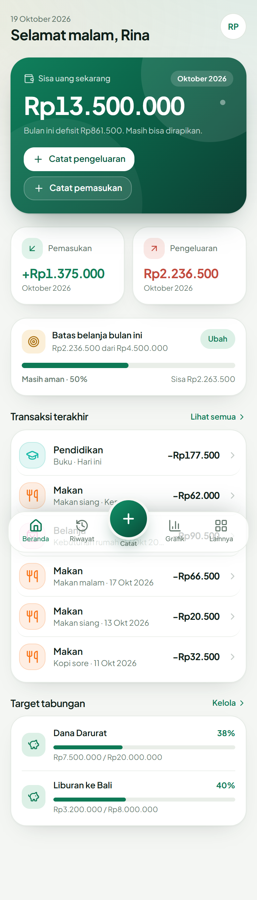
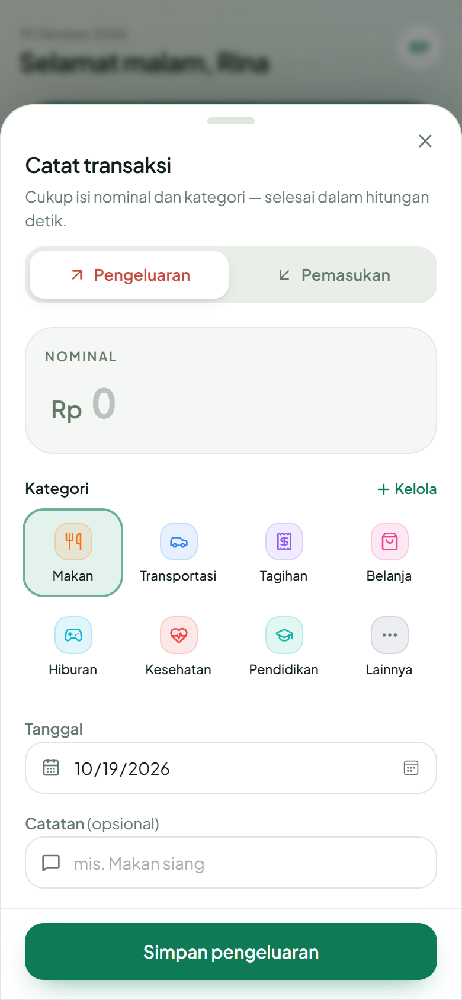
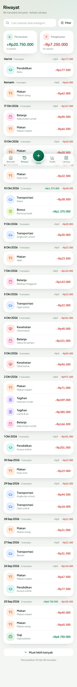
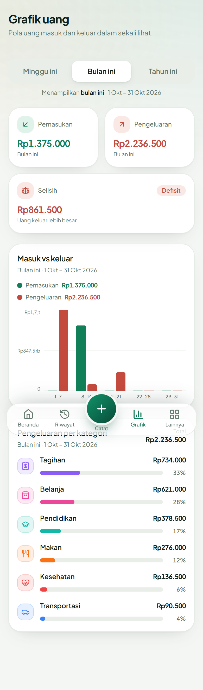
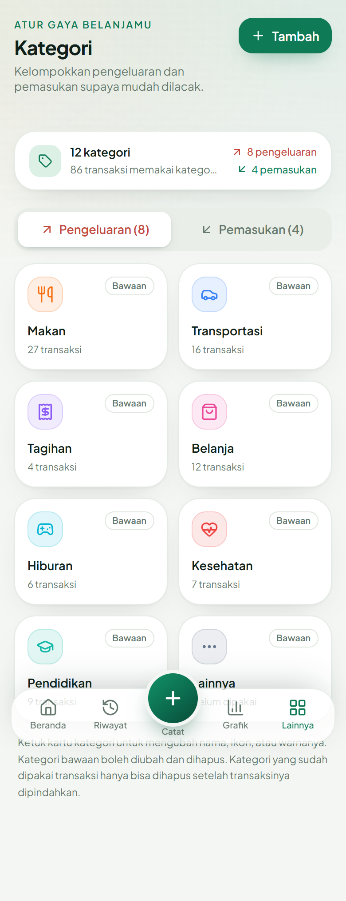
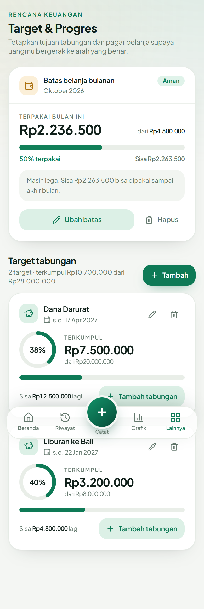
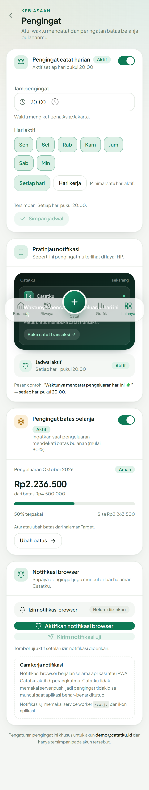
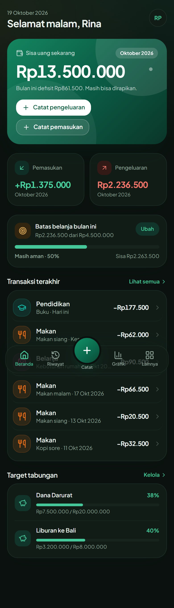
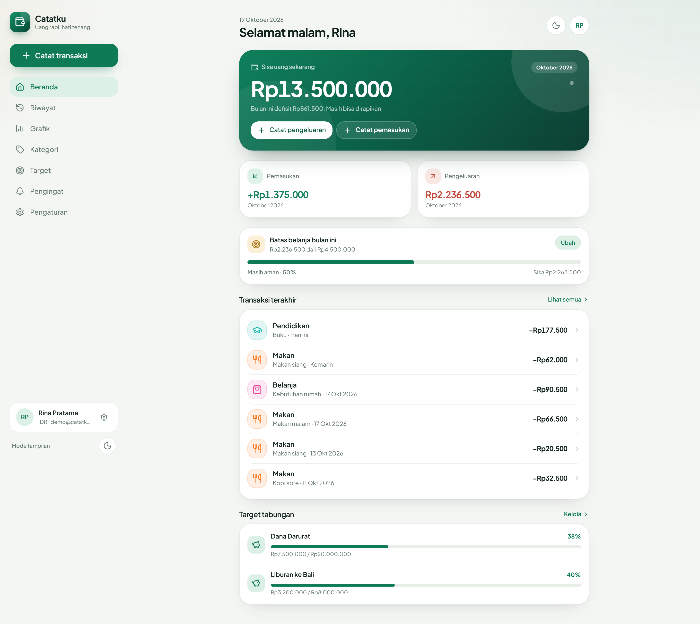

# Catatku — Pencatat Uang Pribadi

Aplikasi **PWA mobile-first** untuk mencatat pemasukan & pengeluaran harian: sisa uang, arus kas bulan ini, grafik, kategori, riwayat, target tabungan, batas belanja, pengingat harian, serta pengaturan akun. Dibangun sesuai PRD (`PRD.md`) dan 8 spesifikasi halaman di folder ini.

## ✨ Fitur

| Fase | Fitur | Status |
| --- | --- | --- |
| 1 | Catat pengeluaran & pemasukan (nominal, kategori, tanggal, catatan) | ✅ |
| 1 | Ubah & hapus transaksi dengan konfirmasi | ✅ |
| 1 | Beranda: sisa uang, ringkasan bulan ini, tombol catat cepat, transaksi terakhir | ✅ |
| 2 | Grafik masuk vs keluar + per kategori, rentang minggu/bulan/tahun | ✅ |
| 2 | Kategori bawaan + CRUD kategori dengan ikon & warna | ✅ |
| 2 | Riwayat: cari, filter (kategori/jenis/tanggal), kelompok per hari, muat lebih banyak | ✅ |
| 3 | Target tabungan (progres %) + batas belanja bulanan + status pemakaian | ✅ |
| 3 | Pengingat harian (jam/hari/toggle) + notifikasi batas belanja + notifikasi browser | ✅ |
| 4 | Daftar/masuk/keluar akun, profil, mata uang, tema terang/gelap | ✅ |
| 4 | Ekspor CSV/JSON + pulihkan cadangan JSON | ✅ |
| — | PWA: manifest, ikon, service worker, offline fallback, install prompt | ✅ |
| — | Data terisolasi per pengguna (sesi cookie + `user_id` di semua tabel) | ✅ |

**Akun demo:** `demo@catatku.id` / `demo12345` — tombol **“Coba akun demo”** di halaman masuk. Berisi ±2,5 bulan transaksi, 2 target tabungan, batas belanja, dan pengingat.

## 📸 Tangkapan layar

| Beranda | Catat transaksi | Riwayat |
| --- | --- | --- |
|  |  |  |

| Grafik | Kategori | Target & progres |
| --- | --- | --- |
|  |  |  |

| Pengingat | Mode gelap | Desktop |
| --- | --- | --- |
|  |  |  |

Semua screenshot dihasilkan dari build produksi dengan akun demo (folder `docs/screenshots/`). Tangkapan login, validasi form, filter riwayat, editor kategori, dan grafik desktop juga tersedia di sana.

## ✅ Verifikasi

- `npm run build` **sukses** — 32 route, middleware, dan pemeriksaan TypeScript bersih.
- Uji end-to-end browser (Edge headless via Playwright): **12/12 alur lulus**, **0 error console/pageerror**, **0 overflow horizontal** pada 390px & 1440px.
  Alur yang diuji: login demo → catat pengeluaran (termasuk validasi nominal kosong) → sisa uang berubah → riwayat cari/ubah/hapus → kategori tambah/ubah/hapus → target buat/tambah tabungan/hapus → toggle pengingat → ganti mata uang USD↔IDR → tema gelap/terang → ekspor CSV/JSON → proteksi rute tanpa sesi → logout → manifest/ikon/service worker.
- PWA: manifest + 4 ikon + `sw.js` terdaftar dan aktif di build produksi.
- `docs/FOUNDATION.md` berisi kontrak internal (skema data, API, komponen) yang dipakai saat pengembangan.


## 🧱 Stack

- **Next.js 15** (App Router, Server Components, Route Handlers) + **React 19** + **TypeScript**
- **Tailwind CSS v4** dengan design token terang/gelap (shadcn-style UI kit ditulis sendiri di `src/components/ui`)
- **Drizzle ORM + SQLite** (`better-sqlite3`), migrasi SQL di `drizzle/`
- **Autentikasi sesi sendiri**: scrypt (`node:crypto`) + cookie HttpOnly + tabel `sessions`, sesuai skema `users`/`sessions` di PRD. *(PRD menyebut Better Auth; karena skema PRD memakai `password_hash`/`sessions.token` sendiri, autentikasi diimplementasikan langsung agar cocok dengan skema tersebut — tanpa dependensi pihak ketiga.)*
- **Zod** untuk validasi input, **Radix UI** untuk dialog/switch, **Sonner** untuk toast, **Lucide** untuk ikon

## 🚀 Menjalankan

> Butuh **Node.js 22.6+** — skrip CLI memanfaatkan dukungan TypeScript native Node. Build produksi diverifikasi di Node 26.

```bash
npm install

# (opsional) generate ulang migrasi setelah mengubah src/lib/db/schema.ts
npm run db:generate

npm run db:migrate     # menjalankan migrasi SQL
npm run db:seed        # membuat akun demo + data contoh (idempoten)
npm run dev            # http://localhost:3100
```

Migrasi juga dijalankan otomatis saat server pertama kali menyentuh database (`src/lib/db/index.ts`), jadi `npm run dev` langsung bisa dipakai.

Perintah lain:

```bash
npm run build          # build produksi
npm start              # jalankan hasil build (port 3100)
npm run typecheck      # tsc --noEmit
npm run db:reset       # hapus DB lalu migrasi + seed ulang
```

### Skrip QA visual (opsional)

```bash
$env:EDGE_PATH="C:\Program Files (x86)\Microsoft\Edge\Application\msedge.exe"
node scripts/visual-check.mjs     # screenshot semua halaman + deteksi error/overflow
node scripts/qa-interactions.mjs  # uji alur CRUD end-to-end + ekspor + proteksi rute
node scripts/qa-diagnose.mjs      # diagnosa layout & error console per halaman
```

Membutuhkan `playwright-core` (devDependency) dan Microsoft Edge/Chrome terpasang; screenshot disimpan ke `docs/screenshots/`.

### Environment

| Variabel | Default | Keterangan |
| --- | --- | --- |
| `DATABASE_PATH` | `./data/app.db` | Lokasi file SQLite |

> Catatan sandbox: repo ini berisi `.npmrc` minimal. Jika cache npm pengguna tidak writable, jalankan `npm` dengan `NPM_CONFIG_CACHE` diarahkan ke folder workspace.

## 🗂️ Struktur

```
src/
  app/
    (auth)/login, register          Halaman masuk & daftar
    (app)/                          Area setelah login (layout + AppShell + AppProvider)
      page.tsx                      Beranda cashflow
      riwayat/  grafik/  kategori/  target/  pengingat/  pengaturan/  catat/
    api/                            Route handlers (auth, transactions, categories, charts,
                                    goals, budgets, reminders, settings, export, import)
    manifest.ts  loading.tsx  error.tsx  not-found.tsx  offline/
  components/
    ui/                             Komponen dasar (button, card, dialog, input, …)
    app/                            AppShell, AppProvider, konteks
    transactions/                   Sheet catat/ubah transaksi, baris transaksi
    history/ charts/ categories/ goals/ budget/ reminders/ settings/ auth/
  lib/
    db/                             schema Drizzle, koneksi + auto-migrate, seed demo
    data.ts                         Query server (transaksi, ringkasan, kategori, target, budget)
    analytics.ts                    Agregasi grafik murni (dipakai server & client)
    auth.ts password.ts             Sesi, scrypt, requireUser
    money.ts date.ts                Format uang (minor units) & tanggal Asia/Jakarta
    validation.ts api.ts            Skema Zod + helper respons API
  middleware.ts                     Proteksi rute berbasis cookie sesi
drizzle/                            Migrasi SQL + journal
scripts/                            migrate / seed / reset
public/                             Ikon PWA + service worker
```

## 🗄️ Skema database

`users`, `sessions`, `categories`, `transactions`, `goals`, `budgets`, `reminders` — semuanya memakai `user_id` untuk isolasi data. Nominal disimpan sebagai **integer satuan terkecil** (Rupiah = 1, USD = cent) agar penjumlahan bebas galat pembulatan. Tanggal transaksi `YYYY-MM-DD` (zona Asia/Jakarta).

## 🔌 API ringkas

Semua endpoint butuh sesi (kecuali auth). Respons error: `{ error, details? }`.

| Method | Endpoint | Fungsi |
| --- | --- | --- |
| POST | `/api/auth/register`, `/api/auth/login`, `/api/auth/logout`, `/api/auth/demo` | Akun & sesi |
| GET | `/api/auth/me` | Profil sesi aktif |
| GET/POST | `/api/transactions` | Daftar (filter/paginasi) & simpan transaksi |
| GET/PATCH/DELETE | `/api/transactions/[id]` | Detail, ubah, hapus |
| GET | `/api/transactions/summary` | Sisa uang + ringkasan bulan ini |
| GET/POST | `/api/categories`; PATCH/DELETE `/api/categories/[id]` | CRUD kategori (hapus diblokir 409 bila dipakai) |
| GET | `/api/categories/options` | Pilihan ikon & warna |
| GET | `/api/charts?range=week\|month\|year` | Agregasi grafik |
| GET/POST | `/api/goals`; PATCH/DELETE `/api/goals/[id]` | CRUD target tabungan |
| GET/PUT/DELETE | `/api/budgets` | Batas belanja bulanan + pemakaian |
| GET/PUT | `/api/reminders` | Pengaturan pengingat |
| PATCH | `/api/settings/profile`, `/api/settings/theme` | Profil, mata uang, tema |
| GET | `/api/export?format=csv\|json` | Unduh cadangan |
| POST | `/api/import` | Pulihkan cadangan JSON |

## 🎨 Catatan desain

- Mobile-first (max-width 2xl), sidebar di desktop, bottom nav 5 tab dengan FAB catat cepat; sheet catat transaksi muncul dari bawah di HP dan sebagai dialog di desktop.
- Tema emerald + aksen emas, kartu `rounded-3xl`, bayangan lembut; mode terang/gelap mengikuti token warna.
- Aksesibilitas: label form, `aria-*`, target sentuh ≥40px, kontras memadai, dukungan `prefers-reduced-motion`.
- Uang selalu ditampilkan lewat `formatMoney` (pemisah ribuan & simbol sesuai mata uang pengguna).

## 📝 Batasan yang diketahui

- **Notifikasi**: pengingat harian & peringatan batas belanja bekerja sebagai notifikasi browser + in-app ketika aplikasi/PWA sedang aktif. Push notification latar belakang sungguhan memerlukan server push (VAPID) + penjadwal; belum disertakan agar aplikasi tetap bisa berjalan tanpa layanan eksternal.
- **Offline**: service worker menyediakan fallback halaman offline dan cache aset, tetapi transaksi baru tetap memerlukan koneksi ke server (sesuai PRD: offline bersifat opsional).
- **Mata uang**: mengganti mata uang mengubah format tampilan, bukan mengonversi nilai historis (sesuai perilaku PRD: “format semua nominal mengikuti mata uang pilihan”).
- Satu batas belanja global per bulan (field `category_id` tersedia di skema untuk batas per kategori di masa depan).

## ✅ Checklist uji manual

1. Daftar akun baru → beranda menampilkan ajakan mencatat (bukan angka kosong), kategori bawaan tersedia.
2. Catat pengeluaran Rp15.000 → sisa uang dan ringkasan bulan ini berubah tanpa reload; transaksi muncul di daftar terakhir.
3. Catat pemasukan → nominal bertanda +, total pemasukan bertambah.
4. Ubah nominal transaksi → ringkasan menyesuaikan; hapus → angka kembali.
5. Buka /riwayat: cari “makan”, filter kategori/jenis/tanggal, reset filter, muat lebih banyak; kelompok tanggal + total harian benar.
6. Buka /grafik: ganti minggu/bulan/tahun → grafik & total berubah instan; rentang kosong menampilkan empty state.
7. Buka /kategori: tambah kategori + ikon/warna, ubah, coba hapus kategori terpakai → pesan penjelasan, bukan terhapus.
8. Buka /target: buat target, tambah tabungan → persen berubah; atur batas belanja → kartu beranda ikut berubah.
9. Buka /pengingat: atur jam & hari, matikan/nyalakan, uji notifikasi browser.
10. Buka /pengaturan: ubah nama & mata uang (mis. USD) → semua nominal ikut format baru; ganti tema; unduh CSV/JSON; pulihkan JSON; keluar → diarahkan ke /login.
11. Buka aplikasi di jendela privat → halaman terproteksi diarahkan ke /login.
